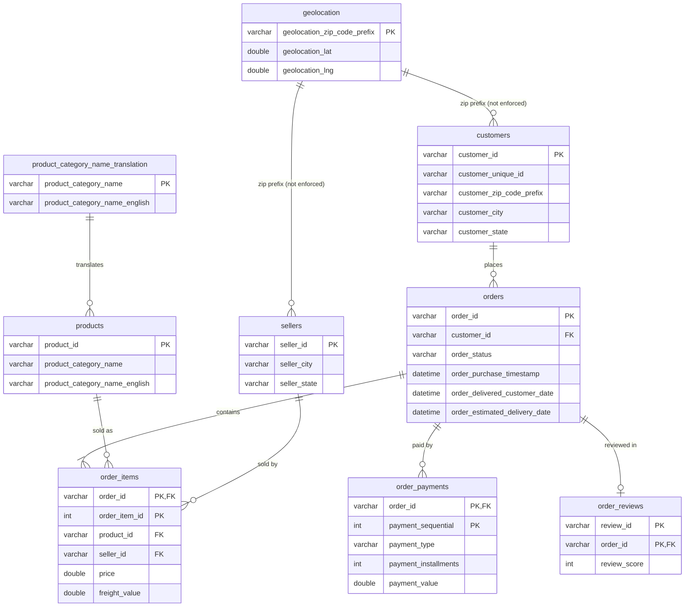

# ER diagram

Relationships implemented in `sql/schema.sql`. (The brief links an official ER diagram that could not be
opened during the build; compare this one against it.)

Zip-prefix links to `geolocation` are not enforced as foreign keys because some customer/seller prefixes
have no geolocation row. Engineered tables (`order_features`, `customer_features`, `seller_features`) are
derived from these tables.
